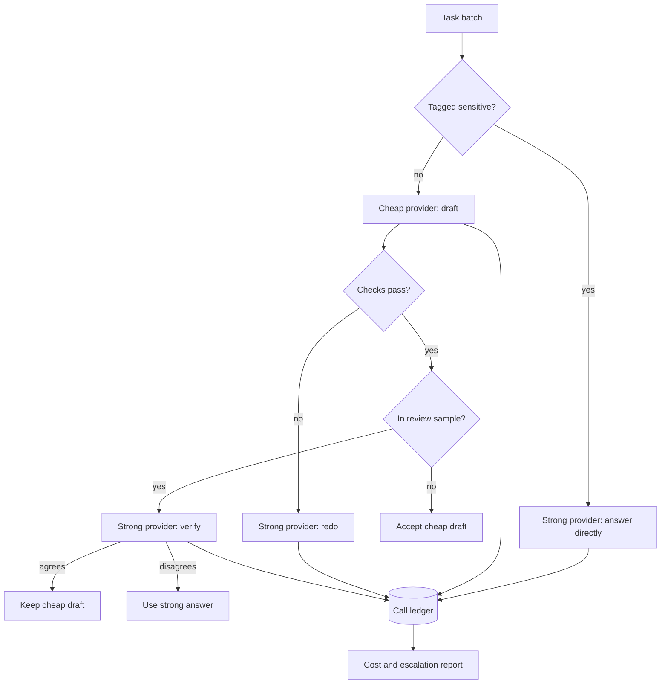

# cheap-first-router

Sending every extract, classify and summarise job to a top tier model is slow and expensive, yet sending everything to a cheap model lets quiet errors through.
This router sends bulk work to a low cost model first, has a strong model check it, and keeps sensitive work on the strong model only.

## What it does

- **Cheap first.** Bulk tasks (`extract`, `classify`, `summarise`) are drafted by a low cost provider.
- **Checks on every draft.** Mechanical checks (required fields, allowed labels, length limits, extracted values grounded in the source text) run with no model call. A failing draft is redone by the strong provider.
- **Sampled review.** A deterministic share of passing drafts is reviewed by the strong provider. If it disagrees, its answer replaces the draft.
- **Sensitive stays strong.** A task tagged `sensitive` (tag set is configurable) goes straight to the strong provider. A guard at the single provider call site raises `SensitiveLeakError` if anything tries to send it elsewhere, and the report carries an audit count that must be zero.
- **Cost and escalation report.** Every call lands in a ledger. The report shows routing counts, escalation rate and reasons, sample disagreement rate, tokens and cost per provider, and savings against an all strong baseline. Text and JSON.
- **Providers behind an interface.** `Provider` has two methods, `complete` and `verify`. The repo ships rule based mocks, so everything runs offline with no keys.

## Architecture



| File | Role |
| --- | --- |
| `src/cheap_first_router/router.py` | Routing policy, sensitive guard, call ledger |
| `src/cheap_first_router/checks.py` | Deterministic checks per task kind |
| `src/cheap_first_router/providers.py` | `Provider` interface and the two mocks |
| `src/cheap_first_router/report.py` | Report builder and text renderer |
| `src/cheap_first_router/synthetic.py` | Invented task batch for the demo and tests |

## Run it

Needs Python 3.10 or newer. There are no runtime dependencies.

```bash
python -m pip install -e ".[dev]"
python -m cheap_first_router --demo 40 --trace
```

To route your own batch, pass a JSONL file with one task per line:

```bash
python -m cheap_first_router --tasks tasks.jsonl --sample-rate 0.2 --json report.json
```

```json
{"id": "A1", "kind": "classify", "text": "I was charged twice.", "labels": ["billing", "other"], "tags": ["sensitive"]}
```

Settings can also come from the environment, see `.env.example`.

## Tests

```bash
python -m pytest -q
```

18 tests cover the sensitive guarantee, each route, the checks, sampling determinism, report reconciliation with the ledger, config and the CLI. CI runs the tests and the demo on Python 3.10 and 3.12 (`.github/workflows/ci.yml`).

## Demo

```bash
python demo/run_demo.py
```

The demo routes 40 synthetic tasks (6 tagged sensitive) through the mocks with a 25 percent review sample and prints one routing line per task followed by the report. It needs no install, network or keys. The captured output is in `demo/output.txt`. The summary from that run:

```text
Tasks: 40  (bulk 34, sensitive 6)
escalated to strong  7  (20.6% of bulk tasks)
sampled for review   8, overturned 1
total cost 0.013, all strong baseline 0.026, saved 50.2%
sensitive tasks sent off the strong model: 0  OK
```

The cheap mock injects faults on purpose (about 15 percent visible to checks, 10 percent plausible but wrong) so there is something to catch. Prices on the mocks are illustrative.

## Using a real model

Subclass `Provider`, set `name`, `tier` and the per million token prices, and implement `complete(task)` and `verify(task, candidate)` with your client of choice. Read keys from the environment. The router refuses a strong slot whose provider does not declare `tier = "strong"`.

## Where this pattern runs

This is drawn from systems that run two small service companies day to day. There, routine reading, tagging and summarising goes to a low cost model, a stronger model judges and spot checks the results, and anything containing customer or staff details stays on the stronger model. This repo is a clean, self contained rewrite of that pattern with invented data.

## Limitations

- The mocks are rules, not models. The strong mock is treated as ground truth, which a real strong model is not.
- Sensitivity is decided by tags that the caller sets. Nothing here detects sensitive content in untagged text.
- Sampling only estimates quality. A plausible but wrong draft that passes checks and is not sampled is accepted. There is a test that shows exactly this.
- The all strong baseline is an estimate from prompt size and final answer size, not a measured run.
- Token counts use a four characters per token approximation. Real providers report their own usage.
- Tasks run one at a time. There is no concurrency, retry, rate limiting or caching.
- Three task kinds with simple checks. Real extraction schemas need their own checks.

## License

License: MIT, see the LICENSE file.
