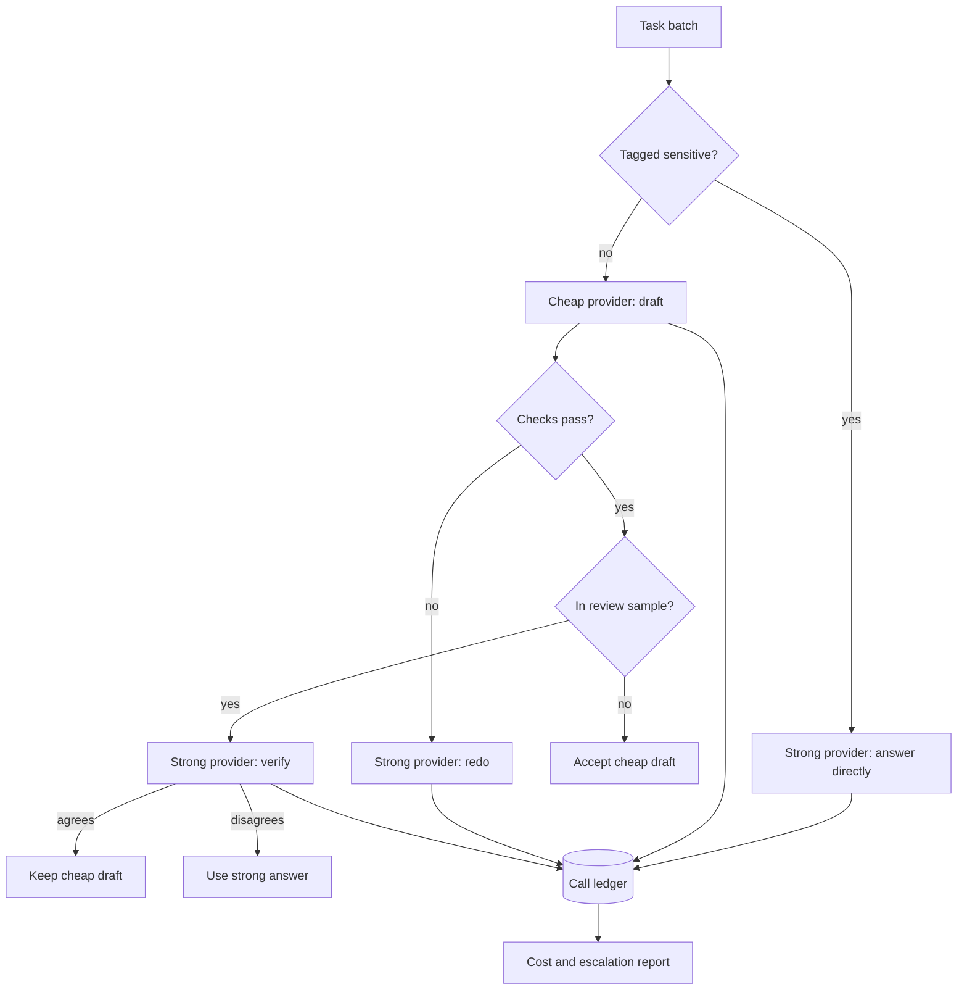

# cheap-first-router

**For teams whose LLM bill is dominated by routine bulk work** (pulling fields out of messages, tagging tickets, summarising notes) and who cannot afford quiet errors or sensitive records going to a low cost vendor.

Sending every such job to a top tier model is expensive. Sending everything to a cheap model lets wrong answers through unnoticed. This router does the middle thing and shows its working:

1. Bulk tasks are drafted by a low cost model.
2. Every draft gets mechanical checks (no model call). A failing draft is redone by the strong model.
3. A fixed share of the passing drafts is reviewed by the strong model, which overrules the draft if it disagrees.
4. Anything tagged sensitive goes to the strong model only, with a guard and an audit count to prove it.
5. Every call is priced in a ledger, and a report shows what was escalated, why, and the cost against an all strong baseline.

**What this repo is:** a small Python reference implementation (under 800 lines of source, no runtime dependencies) of that routing policy, with 25 tests. **What it is not:** it ships with rule based mock providers only. It has never been run against a hosted model, and the cost figures below come from made up prices. See [Limitations](#limitations).

## What you will see

`python demo/run_demo.py` routes 40 invented tasks (6 tagged sensitive) through the mocks. Lines below are copied from that run (`...` marks lines left out, full capture in `demo/output.txt`):

```text
T003  summarise  escalated_checks       final=strong summary_too_long,summary_not_shorter
T004  extract    sensitive_strong_only  final=strong 
T005  classify   cheap_verified         final=cheap  
T006  summarise  cheap_accepted         final=cheap  
...
T015  summarise  escalated_sample       final=strong 
...
Tasks: 40  (bulk 34, sensitive 6)
...
  escalated to strong         7  (20.6% of bulk tasks)
  sampled for review          8
  sample overturned           1  (12.5% of sampled)
  accepted unreviewed        20
...
  total                                     0.013008
  baseline, all strong (estimate)           0.026125
  saved                                     0.013117  (50.2%)
...
  sensitive tasks sent off the strong model: 0  OK
```

Read the 50.2 percent as arithmetic on the demo's inputs, not a result: the mock prices are invented (strong is 20 times the cheap input price), the cheap mock is told how often to fail, and the baseline is an estimate. Your saving depends on your real price gap, escalation rate and sample rate.

## What it does

- **Cheap first.** Bulk tasks (`extract`, `classify`, `summarise`) are drafted by the cheap provider.
- **Checks on every draft.** Required fields, allowed labels, length limits, and extracted values that must appear word for word in the source text. No model call.
- **Sampled review.** A deterministic share of passing drafts (hash of seed and task id) is reviewed by the strong provider.
- **Sensitive stays strong.** A task carrying a sensitive tag (tag set is configurable) skips the cheap provider. A guard at the single provider call site raises `SensitiveLeakError` if anything tries to send it elsewhere, and the report carries an audit count that must be zero.
- **Cost and escalation report.** Routing counts, escalation rate and reasons, sample disagreement rate, tokens and cost per provider, savings against an all strong baseline. Text and JSON.
- **Providers behind an interface.** `Provider` has two methods, `complete` and `verify`. Only the two offline mocks are included.

## Architecture



| File | Role |
| --- | --- |
| `src/cheap_first_router/router.py` | Routing policy, sensitive guard, call ledger |
| `src/cheap_first_router/checks.py` | Deterministic checks per task kind |
| `src/cheap_first_router/providers.py` | `Provider` interface and the two mocks |
| `src/cheap_first_router/report.py` | Report builder and text renderer |
| `src/cheap_first_router/synthetic.py` | Invented task batch for the demo and tests |

## Run it

Needs Python 3.10 or newer. There are no runtime dependencies; the `dev` extra adds pytest.

```bash
python -m venv .venv
source .venv/bin/activate        # Windows: .venv\Scripts\activate
python -m pip install -e ".[dev]"
python -m cheap_first_router --demo 40 --trace
```

To push your own batch through the routing policy, pass a JSONL file with one task per line:

```bash
python -m cheap_first_router --tasks tasks.jsonl --sample-rate 0.2 --json report.json
```

```json
{"id": "A1", "kind": "classify", "text": "I was charged twice.", "labels": ["billing", "other"], "tags": ["sensitive"]}
```

The command line always uses the mock providers, so the answers it gives for your file are keyword rules, not model output. It is useful for seeing the routing and the report shape. Task ids must be unique. `extract` needs `fields`, `classify` needs `labels`, `summarise` takes an optional `max_words`. Bad input exits with code 2 and names the line.

Settings can also come from the environment (`CFR_SAMPLE_RATE`, `CFR_SEED`, `CFR_SENSITIVE_TAGS`), see `.env.example`. The package does not load a `.env` file itself.

## Tests

```bash
python -m pytest -q
```

25 tests cover the sensitive guarantee, each route, the checks, sampling determinism, report reconciliation with the ledger, input validation, config and the CLI. CI runs the tests and the demo on Python 3.10 and 3.12 (`.github/workflows/ci.yml`).

## Demo

```bash
python demo/run_demo.py
```

Routes 40 synthetic tasks through the mocks with a 25 percent review sample and seed 1, printing one routing line per task and then the report. It needs no install, network or keys, and the output is the same on every run. The cheap mock injects faults on purpose (about 15 percent visible to checks, about 10 percent plausible but wrong) so there is something to catch.

## Using a real model

Not included; this is the work a real deployment still needs. Subclass `Provider`, set `name`, `tier` and the per million token prices, and implement `complete(task)` and `verify(task, candidate)` with your client of choice, returning the token usage the vendor reports. Read keys from the environment. The router refuses a strong slot whose provider does not declare `tier = "strong"`. To run your provider you call `Router` from Python; the command line is wired to the mocks.

## Where this pattern comes from

The author runs the same pattern in private day to day systems: routine reading, tagging and summarising goes to a low cost model, a stronger model judges and spot checks, and anything containing customer or staff details stays on the stronger model. None of that code or data is here, and nothing in this repo demonstrates it. This is a self contained rewrite with invented data.

## Limitations

- **Everything model shaped is mocked.** Both providers are regex and keyword rules. No hosted model, SDK or API has ever been called by this code, so prompt design, response parsing, malformed model output, timeouts and vendor errors are all untested.
- **The savings figure is not a measurement.** Prices are invented, token counts use a four characters per token guess, the fault rates are parameters of the mock, and the all strong baseline is estimated from prompt size and final answer size.
- **The strong mock is treated as ground truth.** A real strong model is sometimes wrong, and a real reviewer can wrongly overturn a correct draft. Nothing here measures that.
- **Sensitivity is decided by tags the caller sets.** Nothing detects sensitive content in untagged text. The guard also trusts each provider's declared `tier`; a provider mislabelled as strong would pass it.
- **Sampling only estimates quality.** A plausible but wrong draft that passes checks and is not sampled is accepted. In the demo 20 of 34 bulk answers are accepted with no review, and a test shows a wrong label slipping through this way.
- **The checks fit the demo data.** Three task kinds. The phone check only accepts the `555-0100` seven digit shape, the grounding check is an exact substring match, and there is no check that a summary is faithful. Real schemas need their own checks.
- **No operational features.** Tasks run one at a time in memory. No concurrency, retry, rate limiting, caching, persistence of the ledger, or budget cap.

## License

License: MIT, see the LICENSE file.
